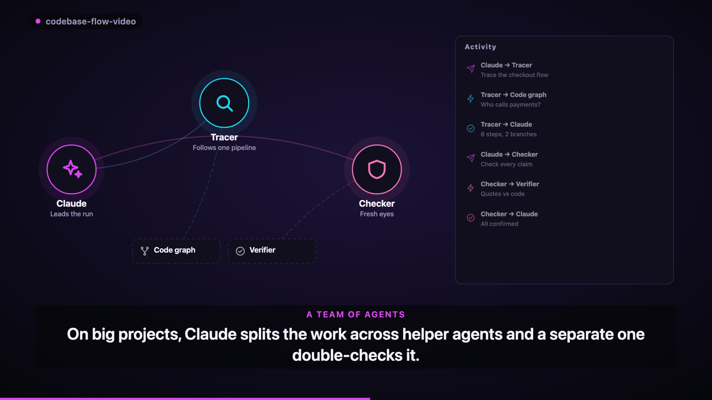

# codebase-flow-video

**Your codebase, explained in one video. Checked against the real code.**

[](docs/assets/promo-16x9.mp4)

`codebase-flow-video` is a Claude Code plugin that reads your project with a code graph, checks every claim against the code, and turns it into an animated explainer that **shows the product working**: agents talking and calling tools, a chat answering with sources, requests being checked, records changing as they move through a pipeline, real screenshots of your app. It uses your brand colours and fonts, adds an original music track, and renders 16:9, 1:1 and 9:16, with a post ready to share.

The video above was rendered by the plugin itself, from a hand-written storyboard. ([launch site](https://faizankhan789.github.io/codebase-flow-video/))

## Install

```bash
/plugin marketplace add faizankhan789/codebase-flow-video
/plugin install codebase-flow-video@codebase-flow-video
```

Then ask, inside any project: *"Make a video of how this codebase works."* On first use Claude runs the renderer setup (Playwright + headless Chromium + tree-sitter parsers, about 175 MB).

<details>
<summary>No plugin installer? Copy the skill directly.</summary>

```bash
git clone https://github.com/faizankhan789/codebase-flow-video
rsync -a --exclude node_modules codebase-flow-video/skills/codebase-flow-video/ ~/.claude/skills/codebase-flow-video/
```

Restart Claude Code after copying.
</details>

### Also works with

The skill is exposed at each agent's standard discovery path through symlinks to `skills/codebase-flow-video/`.

| Agent | How it finds the skill |
|---|---|
| **Claude Code** | the plugin install above, or `.claude/skills/codebase-flow-video/` |
| **Codex CLI** | `.agents/skills/codebase-flow-video/` |
| **opencode** | `.opencode/skills/codebase-flow-video/` |
| **Gemini CLI / Antigravity** | `.agents/skills/codebase-flow-video/` |
| **Any other agent** | point its custom instructions at `skills/codebase-flow-video/SKILL.md` |

Or with the [`skills`](https://github.com/vercel-labs/skills) CLI: `npx skills add https://github.com/faizankhan789/codebase-flow-video --skill codebase-flow-video`.

> **Windows:** symlinks need `git config core.symlinks true` (or `git clone -c core.symlinks=true`) and Developer Mode; otherwise copy `skills/codebase-flow-video/` into the agent's skill folder.

## Use it

```text
Make a video of how this codebase works.
```

Steer it in plain words or with options:

```text
/codebase-flow-video --style ledger --audience investors --format 1x1
/codebase-flow-video only the checkout pipeline, with real screenshots (--screens)
/codebase-flow-video --music ~/Music/track.mp3        # or --no-music
```

| Option | Values | Default |
|---|---|---|
| `--style` | `auto`, `midnight`, `daylight`, `neural`, `ledger`, `storefront`, `clinic`, `terminal`, `boardroom`, `ocean`, `candy` | `auto`: your brand + a preset for your domain |
| `--audience` | `linkedin`, `clients`, `executives`, `investors`, `developers` | `linkedin` |
| `--format` | `16x9`, `1x1`, `9x16`, `all` | `all` |
| `--screens` | capture the running app (asks first; local/staging, demo data) | off |
| `--music FILE` / `--no-music` | your track / silent | an original generated track |
| `--cut` | `full`, `highlights` (≤ 60 s) | `full` |

Everything lands in `flow-video/` in your repo:

```
FLOW.md            every pipeline, step and branch, with file:line and the exact code
storyboard.json    the story: scenes, visuals, style
flow-16x9.mp4      meetings, YouTube        flow-1x1.mp4   LinkedIn feed
flow-9x16.mp4      Reels, Shorts, Stories   share.md       LinkedIn / X post, ready to paste
```

Add `flow-video/` to `.gitignore` if you don't want to commit the videos.

## Scenes that fit the code

| Your code has… | The video shows |
|---|---|
| LLM agents, planners, tool calls (LangGraph, CrewAI, AutoGen, Agents SDK…) | **agents** thinking, handing off and calling tools, with an activity log |
| A chat assistant or RAG | a **chat** that types, streams the answer and shows its sources |
| API routes with validation | a **request** checked step by step, saved and answered |
| ETL, extraction, enrichment | one **record** changing as it moves through each stage |
| Business branches | a **decision** with every outcome |
| Validations, fraud rules, guardrails | a **checklist** ticking to a verdict |
| Background jobs | a **queue** with workers and retries |
| A web or mobile UI | real **screenshots**, highlights measured from the page |
| A key rule (developer audience) | the real **code**, line by line |

A box-and-arrow map is still there for an overview shot. Scene reference: [`references/visuals-guide.md`](skills/codebase-flow-video/references/visuals-guide.md).

## How it works

1. **Graph.** `graph.mjs` indexes the repo with tree-sitter (JavaScript, TypeScript, Python, Go, Java, Ruby, PHP, C#, C++, Rust, Bash): entry points, calls, branches, external services. Claude asks small questions (`calls`, `path`, `branches`, `show`) instead of reading whole files, which keeps token use low on big repos; only changed files are re-parsed.
2. **Map.** Claude traces each entry point to its effects and writes `FLOW.md`: every step and branch with `file:line` and the exact code, plus a Coverage section that reconciles what was found against what was traced.
3. **Verify.** `verify-flow.mjs` checks every cited file, line and quote against the code; a fresh reviewer agent checks what each claim means. A second check compares the storyboard with `FLOW.md`.
4. **Look.** `detect-style.mjs` reads your brand (Tailwind, CSS variables, theme files, Android, Flutter, iOS, web manifest, fonts) and suggests a style preset and scene types from your dependencies.
5. **Story.** Claude writes `storyboard.json`: plain-language scenes, each pointing back to `FLOW.md`. The renderer refuses to render if a branch is neither shown nor deliberately left out, and flags claims ("instantly", "secure", "always") the code does not prove.
6. **Render.** A deterministic engine animates every frame in headless Chromium, `music.mjs` composes a track that changes chord on each scene, and ffmpeg encodes H.264 + AAC. Optional: `capture.mjs` screenshots your running app first.

Run the tools by hand from a clone:

```bash
cd skills/codebase-flow-video
bash renderer/setup.sh
node renderer/render.mjs examples/helpdesk-agents/storyboard.json --out /tmp/demo   # animated scenes
node renderer/graph.mjs index /path/to/repo && node renderer/graph.mjs --repo /path/to/repo summary
node renderer/detect-style.mjs /path/to/repo
node renderer/verify-flow.mjs /path/to/repo/flow-video/FLOW.md
(cd renderer && npm test)
```

## Requirements

- [Claude Code](https://claude.com/claude-code), or another agent that supports Agent Skills
- Node.js 18+
- ffmpeg on `PATH`: `brew install ffmpeg` (macOS), `sudo apt-get install ffmpeg` (Ubuntu), `winget install ffmpeg` (Windows)

## What's in this repo

- `skills/codebase-flow-video/`: the skill
  - `SKILL.md`: workflow and options
  - `references/`: analysis, verification, storyboard, visuals, screens and share guides
  - `renderer/`: code graph, verifier, style detection, screenshot capture, music, renderer engine and tests
  - `examples/`: example storyboards (fictional products)
- `docs/`: the launch site (GitHub Pages) and video assets
- `.claude-plugin/`: plugin manifest and marketplace catalog
- `.claude/skills/`, `.agents/skills/`, `.opencode/skills/`: symlinks to the skill for other agents

## Credits

- Parsing: [tree-sitter](https://tree-sitter.github.io/) via [`@vscode/tree-sitter-wasm`](https://github.com/microsoft/vscode-tree-sitter-wasm) (MIT)
- Rendering: [Playwright](https://playwright.dev/) + headless Chromium, [ffmpeg](https://ffmpeg.org/)
- Music: composed by `music.mjs` for each video; no samples, nothing to license

## Contributing

Ideas, new scene types, style presets and bug reports are welcome: open an issue or a pull request.

## Star History

<a href="https://www.star-history.com/#faizankhan789/codebase-flow-video&Date">
 <picture>
   <source media="(prefers-color-scheme: dark)" srcset="https://api.star-history.com/svg?repos=faizankhan789/codebase-flow-video&type=Date&theme=dark" />
   <source media="(prefers-color-scheme: light)" srcset="https://api.star-history.com/svg?repos=faizankhan789/codebase-flow-video&type=Date" />
   
 </picture>
</a>

## License

MIT
